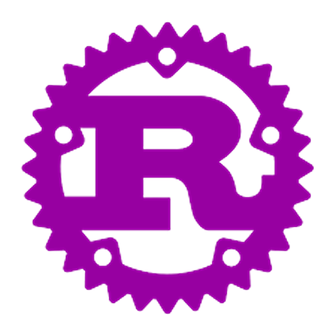

# Projects

Meine Programme, die ich während meines Rust-Lernprozesses erstelle.  
Die meisten Programme sind **klein** und **terminalbasiert**, das rust-logo Projekt ist eine Animation für den **ESP32-S3 Microcontroller** mit LCD-Display.

---

## Rust installieren

1. Rust Toolchain installieren:

```bash
curl --proto '=https' --tlsv1.2 -sSf https://sh.rustup.rs | sh
rustup update

rustc --version
cargo --version
```
## Projekte installieren

2. Repository klonen und ausführen

```bash
git clone https://github.com/vitalij-12/Projects.git
cd Projects

cargo run <programmname>
```


